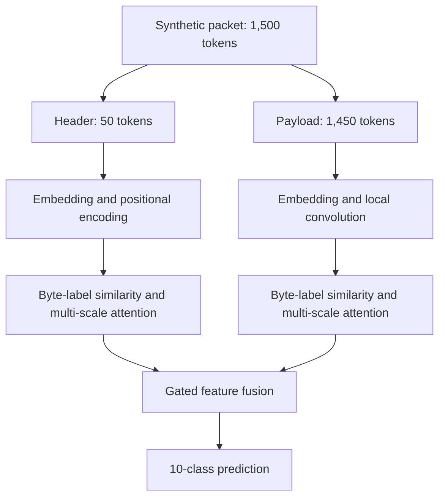

# SOTA-RBLJAN-

[](https://www.python.org/)
[](LICENSE)
[]()

## 📌 Overview
**SOTA-RBLJAN-** is a repository dedicated to state-of-the-art (SOTA) research implementation, reproduction, and experimentation. This project focuses on high-performance algorithmic solutions, robust data processing, and advanced machine learning frameworks.

---

## 📂 Repository Structure
```text
SOTA-RBLJAN-/
├── RBLJAN_SOTA_Reproduction_(1)....py  # Core reproduction and implementation script
├── README.md                            # Project documentation
└── ...
</div>Research status: synthetic-data prototype and code-level reproduction study. The saved results are not measurements on the original USTC-TFC dataset, and do not establish state-of-the-art performance. “SOTA-RBLJAN++” is the original notebook's model name.

At a glance
Saved main experiment	Proposed model	Local baseline
Macro-F1	81.78%	37.96%
Clean accuracy	83.80%	46.80%
Accuracy with 500 inserted bytes	83.80%	43.80%
Classifier parameters	426.18 K	153.74 K
Batched inference time per packet	0.4554 ms	0.1614 ms


What the numbers mean: the saved synthetic run reports a 43.82 percentage-point macro-F1 gain, alongside 2.77× the classifier parameters and 2.82× the batched inference time. Accuracy is unchanged across the tested insertion lengths; this is not a guarantee against other attacks or evidence that every individual prediction stayed unchanged.
Model at a glance

What is implemented?
The notebook converts byte tokens into learned representations and processes the header and payload separately. Byte–label similarity and attention summarize each branch before classification.

The proposed extension adds:
- Multi-scale byte attention: header windows 5, 11, 17; payload windows 9, 25, 65.
- Depthwise convolutional context for payload embeddings.
- Learned similarity scaling, feature gating and label regularization.
- A Gumbel-softmax straight-through generator path for learned payload augmentation.
- Packet-level ablations, a synthetic flow experiment, random byte-insertion tests and attention visualizations.
These are implemented design choices, not independently isolated improvements. Equal-budget, capacity-matched experiments are still needed.
Run in Google Colab
1. Open RBLJAN_Reviewed.ipynb using the badge above.
2. Select a GPU runtime if available. The original saved metadata identifies a T4 GPU; timings are environment-specific.
3. Restart the runtime, then run the notebook from the beginning. The Drive mount cell is optional unless you want Drive storage.
4. The main experiment generates its data locally: no real traffic dataset is downloaded.
5. The final reviewed metrics section evaluates the existing trained models and exports reviewed_metrics/metrics.csv, per-class CSVs, confusion matrices and .npz prediction files.
6. Save the executed notebook with outputs and archive the exported files with the run configuration.
Imports include Python, PyTorch, NumPy, pandas, matplotlib and scikit-learn. Dependencies are not yet locked to a fully validated environment. The reviewed copy passes Python syntax checks; a complete training rerun has not been performed as part of the review.
Experiment configuration
Setting	Main packet experiment	Flow experiment
Data	Generated synthetic byte arrays	Groups of synthetic packets
Train / test	1,600 / 500	400 / 120 flows
Classes	10 synthetic categories	10 synthetic categories
Header / payload	50 / 1,450 tokens	15 packets per flow
Embedding dimension	256	128
Batch size	64	16
Epochs	6 for ablations; 8 for full models	6
Dataset seeds	42 / 100	42 / 100


Malware-family names are category labels in the generator. They do not mean that real malware captures were loaded. Training and test payload motifs are generated separately, while several header cues remain class-dependent.
Saved classification results
Variant	Macro-F1
Without label attention	30.80%
Without header/payload separation	21.81%
Without generator	40.77%
Full local baseline	37.96%
Proposed extension	81.78%


The flow experiment reports 54.17% macro-precision, 61.19% macro-recall and 52.82% macro-F1. It is a separate experiment, not an improvement over the original paper's flow benchmark.
Saved robustness results
Inserted bytes	No generator	Local baseline	Proposed
0	45.80%	46.80%	83.80%
50	46.40%	47.00%	83.80%
100	42.00%	46.60%	83.80%
150	42.60%	46.60%	83.80%
200	41.80%	45.20%	83.80%
250	36.40%	45.60%	83.80%
300	37.40%	43.80%	83.80%
350	39.20%	45.80%	83.80%
400	37.40%	44.20%	83.80%
450	38.00%	44.60%	83.80%
500	39.80%	43.80%	83.80%


The evaluator inserts random bytes before the payload and truncates to 1,450 tokens. The header is unchanged. This tests one perturbation family; stable synthetic header cues may help explain the flat proposed-model curve.
Important review findings
Final metrics section corrected
The original section 13 redefines the dataset and classifier, overwrites the trained model variables, and initializes an ordinary baseline as the proposed-model proxy. It evaluates those fresh models without training them. Its 6–12% accuracies and associated MSE/RMSE/R² plot are therefore excluded from the main experiment's conclusions.

RBLJAN_Reviewed.ipynb replaces this block with evaluation of the existing trained models. It checks that the proposed model has the expected class and that the packet test set has 500 samples. It exports predictions and uses a multiclass Brier score for probability quality. All outputs in this reviewed copy are cleared to avoid presenting old results as outputs of edited code.
Remaining experimental limitations
- Baseline generator is not trained: train_rbljan_baseline has only a classifier optimizer and calls the generator under torch.no_grad().
- Training is not matched: optimizer, capacity and epoch budgets differ.
- Random insertions are drawn separately for each model: use saved shared perturbations for paired comparisons.
- No independent repeated runs, confidence intervals or validation-based selection are supplied for the main experiment.
- Run provenance is incomplete: most original execution counters are null despite saved outputs.
- Attention is a diagnostic: high weights do not prove causal explanations or guaranteed robustness.
The evaluation fix does not repair these training-design limitations. No new performance result is claimed for the corrected notebook.
Files
File	Purpose
RBLJAN_SOTA_Reproduction_(1).ipynb	Original notebook with saved evidence, preserved unchanged
RBLJAN_Reviewed.ipynb	Evaluation-corrected copy; restart and rerun required
README.md	Setup, results and transparent scope
REVIEW_REPORT.md	Repository code review and results analysis


Next validation steps
- [ ] Obtain and document the original real dataset and preprocessing protocol.
- [ ] Train the baseline generator with a verified gradient path.
- [ ] Match train/validation/test splits, seeds, epoch budgets and optimizer settings.
- [ ] Test header-only and payload-only controls, and equal-capacity models.
- [ ] Reuse identical perturbation arrays across models.
- [ ] Save checkpoints, raw predictions, environment versions and split identifiers.
- [ ] Report multiple training seeds with mean and variability.
Reference and attribution
Xi Xiao et al., “RBLJAN: Robust Byte-Label Joint Attention Network for Network Traffic Classification,” IEEE Transactions on Dependable and Secure Computing, vol. 22, no. 3, pp. 2161–2178, 2025. DOI: 10.1109/TDSC.2024.3478838.

This repository is an independent reproduction study and extension prototype. It is not the authors' official implementation. No license is asserted here: select and add a license only after confirming rights to the included material.
